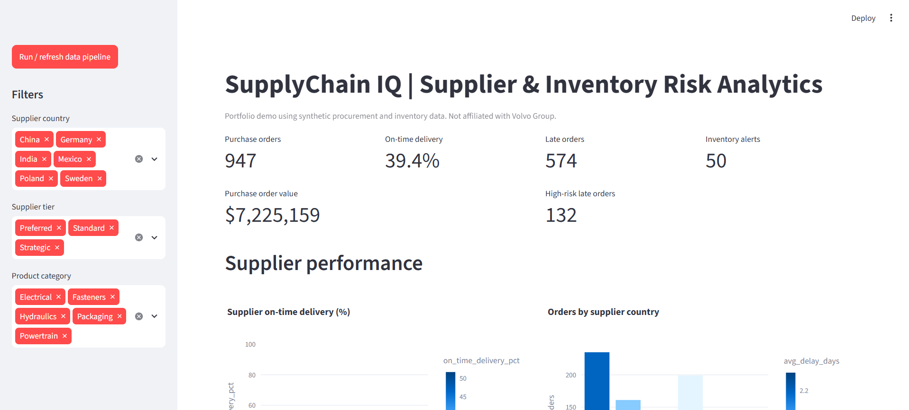

# SupplyChain IQ — Supplier & Inventory Risk Analytics

A portfolio project for logistics, procurement, and operations analytics roles. It combines a data pipeline, relational joins, supplier scorecards, inventory risk rules, and an interactive dashboard.

**Data transparency:** All starter data is synthetic.

## Features
- Generates related supplier, product, inventory, and purchase-order datasets.
- Validates and cleans purchase orders (invalid quantities/costs, duplicate PO IDs, missing lead-time handling).
- Joins orders to supplier and product tables.
- Calculates on-time delivery, average lead time, average delay, order count, and spend by supplier.
- Flags inventory risks using safety stock, reorder points, days of cover, and excess-stock thresholds.
- Creates late purchase-order risk worklists; delays of 7+ days are marked high risk.
- Loads curated tables into SQLite and exports CSV scorecards and alerts.
- Interactive Streamlit/Plotly dashboard with filters and downloadable worklists.

## Run on Windows
 run in PowerShell:
```powershell
py -3 -m venv .venv
.\\.venv\\Scripts\\Activate.ps1
python -m pip install -r requirements.txt
python run_pipeline.py
streamlit run dashboard.py
```

## Workflow
CSV source tables -> Pandas validation and transformations -> SQLite analytical tables -> CSV reports -> Streamlit/Plotly dashboard.

## Input schema
- `suppliers.csv`: supplier_id, supplier_name, supplier_country, supplier_tier, contracted_lead_time_days
- `products.csv`: product_id, product_name, category, unit_cost_usd, reorder_point_units, safety_stock_units
- `inventory.csv`: product_id, stock_on_hand_units, avg_daily_demand_units, open_po_units, last_updated
- `purchase_orders.csv`: po_id, order_date, supplier_id, product_id, quantity_units, unit_cost_usd, promised_lead_time_days, actual_lead_time_days

The starter generates these files automatically if all four are not present. If replacing them, preserve column names and valid supplier/product keys.

## Outputs
- `data/processed/supplychain_iq.db`
- `data/processed/purchase_orders_clean.csv`
- `data/processed/inventory_risk.csv`
- `reports/supplier_scorecard.csv`
- `reports/purchase_order_risk.csv`
- `reports/inventory_alerts.csv`
- `reports/pipeline_summary.csv`



